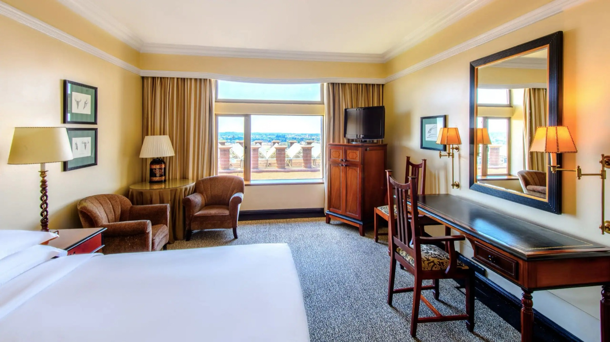
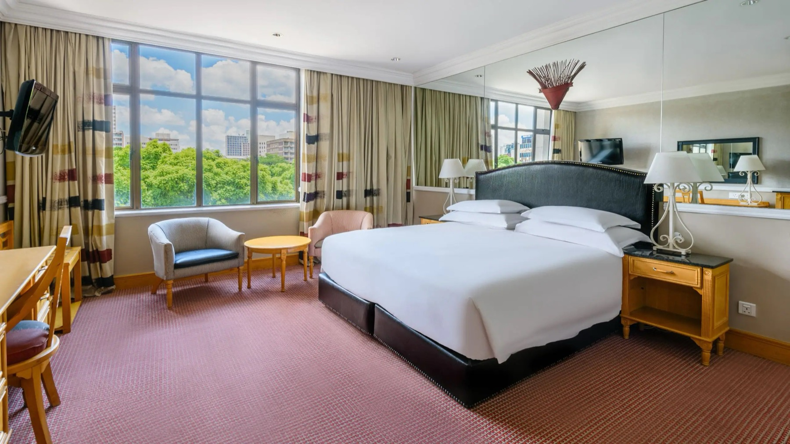
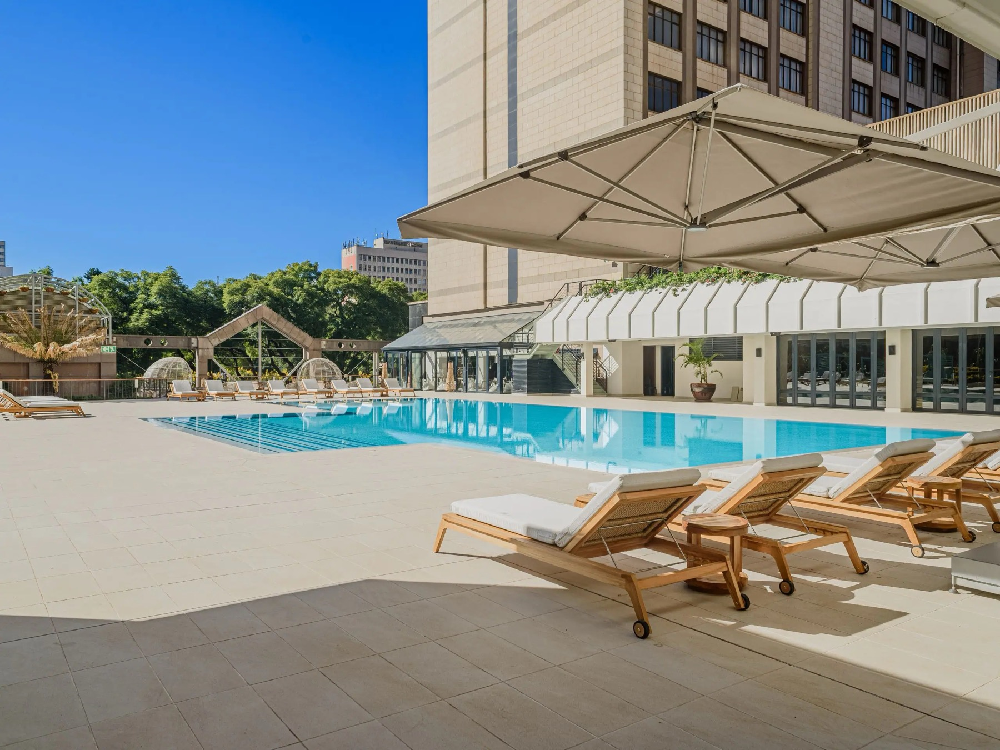

Africa Unity Square has had the same hotel on its corner since 1915. The Meikle brothers, John, Thomas and Stewart, built it when the square still carried Cecil Rhodes's name, and in the 111 years since, the Meikles has never closed. Through the Depression, the war, independence and the decades of upheaval that followed, the doors on Jason Moyo Avenue stayed open and the doormen stayed in their places. In a city that has lost most of its landmarks to neglect, that alone is worth a paragraph.

In May 2024 the name on the canopy changed. After a US$30 million refurbishment the hotel reopened as Hyatt Regency Harare The Meikles, the first Hyatt in Zimbabwe. The double-barrelled name is deliberate: Hyatt is the operator, and the Meikles is the surname the city still uses. Most people in Harare will go on calling it the Meikles, and the hotel seems content with that.

<section class="hr-wrap" data-stay-section data-stay-label="At a glance" id="hr-glance">
  <aside class="hr-glance" aria-label="At a glance">
    <h2 class="hr-glance-title">Hyatt Regency Harare The Meikles at a glance</h2>
    <dl class="hr-glance-grid">
      
<dt>Where</dt><dd>Jason Moyo Avenue at Third Street, on Africa Unity Square, central Harare</dd>

      
<dt>Opened</dt><dd>1915, by the Meikle brothers. Open every night since</dd>

      
<dt>Rebranded</dt><dd>May 2024, after a US$30m refurbishment</dd>

      
<dt>Rooms</dt><dd>286 when the south wing is fully back, plus two floors of apartments</dd>

      
<dt>Airport</dt><dd>13 km to Robert Gabriel Mugabe International</dd>

      
<dt>Best for</dt><dd>Business travellers who want to walk to meetings, conferences, and a first night home</dd>

    </dl>
  </aside>
</section>

<section class="stay-section" data-stay-section data-stay-label="The refurbishment" id="hr-refurb">
  <h2>The refurbishment</h2>
  
The work came in phases, and it is still coming. The ground and first floors went first: the reception foyer lost the offices that had crept into it over the years, and the space was opened back up to daylight. The old Mirabel conference room on the Jason Moyo side became The Kitchen, the all-day restaurant, with the solid wall along the avenue replaced by glass. The conference and banqueting floors followed, and the hotel now runs ten venues, including La Fontaine, which looks straight out over the square.

  
The rooms are the current phase. The north wing, 133 rooms, has been the whole hotel for a while. The south wing is now reopening floor by floor: nine, ten, eleven and twelve are back, with the lower floors to follow over the coming weeks. When it is finished the hotel will have 286 rooms, down from 313, because two floors have been turned into apartments, from studios to three-bedroom flats, which open for booking shortly.

</section>

<section class="hr-wrap" data-stay-section data-stay-label="The rooms" id="hr-rooms">
  

    <figure><figcaption>North wing: mahogany, a leather-topped desk and the chimney pots of the old city. Photograph: Hyatt Regency Harare The Meikles</figcaption></figure>
    <figure><figcaption>South wing: a king bed, a wall of glass and the tree canopy of Africa Unity Square. Photograph: Hyatt Regency Harare The Meikles</figcaption></figure>
  

</section>

<section class="stay-section" id="hr-rooms-text">
  <h2>The rooms</h2>
  
The two wings have two characters, and it is worth knowing which you are booking. The north wing rooms keep the old hotel's manners: warm walls, a proper mahogany writing desk with a leather top, a pair of club armchairs by the window, framed antelope studies on the wall and the roofline of the old city outside, all terracotta chimney stacks and tin. They feel like the hotel your grandfather stayed in, with the plumbing and the television updated.

  
The south wing rooms are the newer thought. They are brighter and squarer, with a wall of tall windows looking across the tree canopy of the square to the towers beyond, a king bed under a dark leather headboard, striped curtains, a mirrored wall with a single piece of Shona basketwork, and a desk long enough to work at for a week. Water comes in glass bottles filled in the hotel's own bottling room, one of a list of sustainability changes that also includes energy-saving bulbs throughout and the upkeep of the gardens on the square, which the hotel now maintains with the City of Harare.

</section>

<section class="stay-section" data-stay-section data-stay-label="The pool" id="hr-pool">
  <h2>The pool, the spa and the gym at the Meikles</h2>
  
The single best decision of the refurbishment was to move the pool. For decades it sat on the thirteenth floor, out of sight and out of mind. It is now on the first floor, in one open zone with the gym and the spa, and it has become the hotel's living room. The pool is heated and open all year, winter included, free to anyone staying, with a small number of day passes sold to walk-ins at a modest charge. Teak loungers line the deck under broad cream umbrellas, the sandstone tower rises behind, and the trees of the square show over the parapet.

  
The Pool Bar Restaurant, which older Harare will remember as the Can Can, has had its solid walls taken out and replaced with glass, so it serves the pool, the gym and the spa in daylight rather than away from it.

</section>

<section class="hr-wrap" id="hr-pool-photo">
  

    <figure><figcaption>The first-floor pool deck, moved down from the thirteenth floor and open all year. Photograph: Hyatt Regency Harare The Meikles</figcaption></figure>
  

</section>

<section class="stay-section" data-stay-section data-stay-label="Who it suits" id="hr-who">
  <h2>Who it suits</h2>
  
The hotel is honest about its guest. It was redesigned around the business traveller and the conference trade, and every decision in the refurbishment, from the long desks to the ten venues, follows from that. Its advantage is the address: the government block, the corporate head offices and the banks are a walk away, the embassy belt is a short drive, and the airport is 13 kilometres out, which in Harare traffic is a reasonable half hour. Our <a href="/flights/from-harare/">flight pages</a> cover the routes in and out.

  
That same address makes it the obvious first night home for anyone flying in from London, Johannesburg or Dubai: central enough to get a SIM card and a cash exchange done on foot the next morning, grand enough to feel like an arrival. Families and holiday travellers will find the northern suburbs' lodges greener and quieter, and should read <a href="/articles/2026-06-02-where-to-stay-in-harare.html">our guide to where to stay in Harare</a> first, or <a href="/articles/2026-06-02-best-places-to-stay-in-zimbabwe.html">the country-wide guide</a> if the capital is only the first stop. But for the traveller with meetings, the Meikles is back to being the answer.

</section>

<section class="hr-wrap" data-stay-section data-stay-label="The verdict" id="hr-verdict">
  <aside class="hr-score" aria-label="Our rating">
    

      5
      out of 5
      
        <svg viewBox="0 0 24 24" aria-hidden="true"><path d="M12 2.6l2.9 6 6.6.9-4.8 4.6 1.2 6.5L12 17.5l-5.9 3.1 1.2-6.5L2.5 9.5l6.6-.9z"/></svg>
        <svg viewBox="0 0 24 24" aria-hidden="true"><path d="M12 2.6l2.9 6 6.6.9-4.8 4.6 1.2 6.5L12 17.5l-5.9 3.1 1.2-6.5L2.5 9.5l6.6-.9z"/></svg>
        <svg viewBox="0 0 24 24" aria-hidden="true"><path d="M12 2.6l2.9 6 6.6.9-4.8 4.6 1.2 6.5L12 17.5l-5.9 3.1 1.2-6.5L2.5 9.5l6.6-.9z"/></svg>
        <svg viewBox="0 0 24 24" aria-hidden="true"><path d="M12 2.6l2.9 6 6.6.9-4.8 4.6 1.2 6.5L12 17.5l-5.9 3.1 1.2-6.5L2.5 9.5l6.6-.9z"/></svg>
        <svg viewBox="0 0 24 24" aria-hidden="true"><path d="M12 2.6l2.9 6 6.6.9-4.8 4.6 1.2 6.5L12 17.5l-5.9 3.1 1.2-6.5L2.5 9.5l6.6-.9z"/></svg>
      
      
Harare's grand hotel, with the century kept and the pool finally where it belongs.

    

    <dl class="hr-score-rows">
      
<dt>Rooms</dt><dd><i style="width:100%"></i><b>5</b></dd>

      
<dt>Location</dt><dd><i style="width:100%"></i><b>5</b></dd>

      
<dt>Pool, spa and gym</dt><dd><i style="width:100%"></i><b>5</b></dd>

      
<dt>Food and drink</dt><dd><i style="width:90%"></i><b>4.5</b></dd>

      
<dt>Service</dt><dd><i style="width:100%"></i><b>5</b></dd>

      
<dt>Value</dt><dd><i style="width:90%"></i><b>4.5</b></dd>

    </dl>
  </aside>
</section>

<section class="stay-section" id="hr-verdict-text">
  <h2>The verdict</h2>
  
A city's grand hotel has one job, which is to still be there. The Meikles has done that for 111 years and has now been given the money and the care to do it for a good while longer. The refurbishment has been careful: it kept the name, the desks and the doormen, and it moved the one thing that was in the wrong place. With the south wing coming back and the apartments opening, this is the Harare address again.

  <table class="hr-check" aria-label="The checklist">
    <tbody>
      <tr><th scope="row">Rooms</th><td>133 in the north wing now; 286 across both wings once the south wing is fully open. Floors nine to twelve of the south wing are already back.</td></tr>
      <tr><th scope="row">Apartments</th><td>Two floors, studio to three-bedroom, opening for booking in the coming weeks. Self-catering to follow.</td></tr>
      <tr><th scope="row">Pool</th><td>First floor, heated, open all year, free for guests. Day passes for visitors, limited each day.</td></tr>
      <tr><th scope="row">Gym and spa</th><td>Alongside the pool on the first floor.</td></tr>
      <tr><th scope="row">Eating</th><td>The Kitchen, all day, on the Jason Moyo side. The Pool Bar Restaurant on the deck.</td></tr>
      <tr><th scope="row">Meetings</th><td>Ten venues. La Fontaine overlooks Africa Unity Square.</td></tr>
      <tr><th scope="row">Airport</th><td>13 km to Robert Gabriel Mugabe International.</td></tr>
      <tr><th scope="row">Water</th><td>Bottled in-house in recyclable glass, in rooms and event spaces.</td></tr>
    </tbody>
  </table>
</section>

<section class="hr-wrap" id="hr-book">
  <aside class="hr-booking" data-booking-widget aria-label="Book a stay">
    

      <h2 class="hr-booking-title">Book a stay</h2>
      
Live rates and availability from Hyatt. Opens in a new tab.

    

    <form class="hr-booking-form" action="https://www.hyatt.com/shop/rooms/hrerh" method="get" target="_blank" rel="noopener">
      <label class="hr-booking-field">Check in<input type="date" name="checkinDate" required></label>
      <label class="hr-booking-field">Check out<input type="date" name="checkoutDate" required></label>
      <label class="hr-booking-field">Guests
        <select name="adults">
          <option value="1">1 adult</option>
          <option value="2" selected>2 adults</option>
          <option value="3">3 adults</option>
          <option value="4">4 adults</option>
        </select>
      </label>
      <input type="hidden" name="rooms" value="1">
      <input type="hidden" name="kids" value="0">
      <button type="submit" class="hr-booking-cta">Check rates</button>
    </form>
    
Hyatt Regency Harare The Meikles, Jason Moyo Avenue at Third Street, Harare

  </aside>
  
Published in partnership with Hyatt Regency Harare The Meikles. Written from the hotel's briefing, its photographs and our own knowledge of the city. Rates come live from Hyatt.

</section>
