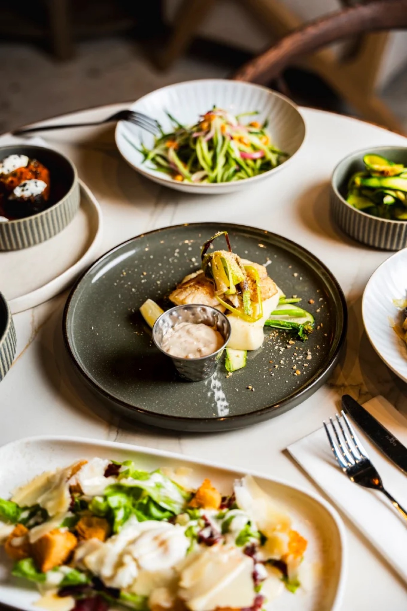

Christmas is Harare's busiest season. The diaspora comes home. Suburbs fill with hired cars and borrowed ones. Every table worth sitting at is booked by someone who waited twelve months for it. If you are flying in for December the city will feed you well. It always could. The question is where to spend your few nights and who to bring.

Harare has no restaurant quarter and no critics. Its good tables hide where the city keeps everything else. Behind suburban walls. Inside a golf club. In a converted house with a pool at its centre. One sits on the ground floor of a hotel that has held its corner since 1915. What ties them together is produce. Beef here is grass-fed. Vegetables taste of soil. Kitchens that do best are the ones that stay out of the way.

Ten restaurants follow in order. Each comes with who to bring, how to book and what to order. Prices are US dollars.

<section class="hr-wrap" data-stay-section data-stay-label="The basics" id="rl-basics">
  <aside class="hr-glance" aria-label="The basics">
    <h2 class="hr-glance-title">The basics</h2>
    <dl class="hr-glance-grid">
      
<dt>Book</dt><dd>WhatsApp the restaurant. December weekends fill early. Book the nights that matter.</dd>

      
<dt>Pay</dt><dd>US dollar cash works everywhere. Visa and Mastercard work at most places. Carry cash because machines drop.</dd>

      
<dt>Phone wallets</dt><dd>Apple Pay and Google Pay are not reliably accepted in Harare yet. Bring the physical card.</dd>

      
<dt>EcoCash</dt><dd>Ask when you book.</dd>

      
<dt>Tip</dt><dd>Ten per cent.</dd>

    </dl>
  </aside>
</section>

<section class="hr-wrap" data-stay-section data-stay-label="The list" id="rl-list">
  <aside class="hr-glance rl-index" aria-label="The list">
    <h2 class="hr-glance-title">The list</h2>
    <ol class="rl-index-list">
      <li><a href="#r1">Victoria 22 and Wine Bar</a>Newlands</li>
      <li><a href="#r2">Amanzi</a>Drew Road</li>
      <li><a href="#r3">The Kitchen at the Meikles</a>City centre</li>
      <li><a href="#r4">Mozambik</a>Greystone Park and Chisipite</li>
      <li><a href="#r5">Tongfu</a>Belgravia</li>
      <li><a href="#r6">Wombles</a>Northern suburbs</li>
      <li><a href="#r7">La Parada</a>Chisipite</li>
      <li><a href="#r8">The Three Monkeys</a>Greendale</li>
      <li><a href="#r9">The Brahman Gastro Pub</a>Sam Levy's Village</li>
      <li><a href="#r10">The Bishop's Mistress</a>Ridgeway North</li>
    </ol>
  </aside>
</section>

<section class="stay-section rl-entry" data-stay-section data-stay-label="Victoria 22" id="r1">
  1
  <h2>Victoria 22 and Wine Bar</h2>
  
22 Victoria Drive, Newlands · US$30 to 70 a head · Modern European

  
This is the night you have been saving. One family has run Victoria 22 since the 1990s and it remains among the most respected restaurants in Harare. In 2020 the sons Lucas and Matthias opened Wine Bar next door. That is where the energy is now. A short menu of small plates changes with the season. A brief cocktail list is very good. You are expected to order widely and share. That suits a table catching up on a year.

  
Three plates made its name. A potato fondant with duck breast and a blueberry red wine sauce. Wasabi tempura prawns with sweet chilli. Pork belly and cucumber salad with ponzu. Finish with the chocolate Amarula malva pudding. It beats every other malva in town. Ask what is on that night because the menu moves.

  
Bring: old friends.

  
Book: WhatsApp, weeks ahead.

  
<b>Pay</b>CashVisa and MastercardContactlessEcoCash: ask

  
Order: the potato fondant with duck breast.

</section>

<section class="stay-section rl-entry" data-stay-section data-stay-label="Amanzi" id="r2">
  2
  <h2>Amanzi</h2>
  
Drew Road, with the original on Enterprise Road · Contemporary

  
Amanzi is for the dinner that marks a trip. An anniversary. An engagement you flew back to announce. A first meal with in-laws. Drew Road is the more intimate of its two addresses. It feels like a gallery and sculpture garden that happens to serve dinner. Artwork changes how the evening feels.

  
Ask for the amuse-bouche when you sit down: focaccia with butter and a clear tomato essence. Open with a classic Manhattan. The menu ranges wide and the kitchen can carry it. That matters when a table spans three generations. Lamb shank in wine sauce for the father. A Bengal fish curry. Pork chops with caramelised pears. Prawn tempura with wasabi mayonnaise. A Naija pepper soup with chicken dumplings. The chocolate bomb at the end is borrowed from London and better than it needs to be.

  
Bring: your parents.

  
Book: WhatsApp, and name the address.

  
<b>Pay</b>CashVisa and MastercardContactless: askEcoCash: ask

  
Order: the lamb shank, then the chocolate bomb.

</section>

<section class="stay-section rl-entry" data-stay-section data-stay-label="The Kitchen" id="r3">
  3
  <h2>The Kitchen at the Meikles</h2>
  
Corner of Third Street and Jason Moyo Avenue, city centre · US$20 to 60 a head · Zimbabwean-inflected global

  
Eat in town on your first night back, before family claims you. The Kitchen sits on the ground floor of Hyatt Regency Harare The Meikles. It occupies what was once the Mirabel conference room and now opens to the avenue through a wall of glass. The hotel above it is the obvious place to sleep off a flight. Its idea is global classics threaded with Zimbabwean ingredients. It lands as intention rather than gimmick.

  
Fresh pita and caponata arrive while you read the menu. Oxtail pasta is closer to a rich stew over pasta than an Italian plate and better for it. Tilapia and ribs are the safe hands. House gin is infused with moringa. A baobab crème brûlée will be the dessert this city talks about once the kitchen sharpens it. There is a weekend brunch. A heated pool upstairs makes a long lunch tempting on the day after you land.

  
Bring: yourself.

  
Book: through the hotel.

  
<b>Pay</b>CashVisa and MastercardCharge to roomContactless: ask

  
Order: the oxtail pasta, then the baobab crème brûlée.

</section>

<section class="hr-wrap" id="rl-photo">
  

    <figure><figcaption>Harare's kitchens do best when they let produce lead. Photograph supplied</figcaption></figure>
  

</section>

<section class="stay-section rl-entry" data-stay-section data-stay-label="Mozambik" id="r4">
  4
  <h2>Mozambik</h2>
  
7 Honey Bear Lane, Greystone Park, and three other branches · US$20 to 70 a head · Portuguese and East African

  
Mozambik's Greystone Park house is one of Harare's best places for a long easy meal. Holidays are built for long easy meals. It is a converted home with a pool at its centre and tables around the water. Its kitchen does what Portuguese-African cooking promises: bold and fresh and generous. On Google it scores 4.7 across 1,500 reviews. No other restaurant in the city matches that at such volume.

  
A small cigar of nuts comes out while you wait. Start with squid heads. Drink the Vinho Verde. Then order the seafood platter with house peri-peri. That is the dish people cross town for. The shrimp and rib platter is its carnivore cousin. Four branches mean one is near wherever family has put you. A bottle of the sauce packs flat for the flight back.

  
Bring: the cousins.

  
Book: WhatsApp the branch you want.

  
<b>Pay</b>CashCard: askContactless: askEcoCash: ask

  
Order: the seafood platter with peri-peri.

</section>

<section class="stay-section rl-entry" data-stay-section data-stay-label="Tongfu" id="r5">
  5
  <h2>Tongfu</h2>
  
Belgravia · Chinese

  
Go with a group. In December that is how anyone goes anywhere. Tongfu is built for a full table ordering across its menu. A meal starts the right way: tea and a rich egg-drop soup with tofu and chicken. Then mains arrive in waves. This is proper regional Chinese cooking rather than the hedged version most cities settle for. It will surprise relatives who think they know Chinese food in Harare.

  
Duck comes crisp-skinned with bones alongside. Sichuan chicken is breaded and fried with groundnuts and dried chillies and numbing peppercorns. People remember it a year later. Whole sea bass is the showpiece and worth the wait.

  
Bring: a big group.

  
Book: phone ahead.

  
<b>Pay</b>CashCard: askEcoCash: ask

  
Order: the Sichuan chicken and the sea bass.

</section>

<section class="stay-section rl-entry" data-stay-section data-stay-label="Wombles" id="r6">
  6
  <h2>Wombles</h2>
  
Northern suburbs · US$30 to 90 a head · Steakhouse

  
Every returning Zimbabwean has one meal they cannot get abroad. For most of us it is beef. Grass-fed Zimbabwean beef is the best argument for eating in this country and Wombles is the steakhouse the city names first. Khaya nyama means house of meat. The phrase sits on its listing and it is accurate. This is a grill and beef is the point. It carries a 4.7 on Google. For a steakhouse that is rare because grills attract complaints the way they attract smoke.

  
It is also the top of this list on price. Spend it here if a proper cut is what you have been missing. Treat everything else on the menu as supporting cast.

  
Bring: your brother.

  
Book: WhatsApp, two weeks ahead.

  
<b>Pay</b>CashCard: askContactless: askEcoCash: ask

  
Order: whatever the waiter says has hung longest.

</section>

<section class="stay-section rl-entry" data-stay-section data-stay-label="La Parada" id="r7">
  7
  <h2>La Parada</h2>
  
Bay Noakes Road, Chisipite · Tapas and cocktails

  
La Parada is where Harare goes to be seen. In December Harare is twice its normal size. This outpost imported its South African original wholesale. A beautiful garden. Tapestry strung across the ceiling. A bar that anchors everything and a cocktail list as long as a menu. Friday and Saturday bring a DJ and the garden becomes something else. On a Tuesday it is a quiet place for a drink. Over the holidays expect the Saturday version most nights.

  
Its menu wanders well beyond Spain. Pork belly bao buns are the thing to order. That tells you most of what you need to know. Service can be uneven on a busy night and every night will be busy. What La Parada sells is atmosphere and it delivers every time.

  
Bring: school friends.

  
Book: WhatsApp a table.

  
<b>Pay</b>CashCard: askContactless: askEcoCash: ask

  
Order: the pork belly bao.

</section>

<section class="stay-section rl-entry" data-stay-section data-stay-label="Three Monkeys" id="r8">
  8
  <h2>The Three Monkeys</h2>
  
16 Greendale Avenue, Greendale · US$20 to 60 a head · Garden restaurant

  
A garden restaurant on a dam with a waterfall at its centre. A deck sits over the water. A shaded playground answers the question every visiting parent asks: where can we take the children. Burgers and pizzas and cocktails are its reputation and they hold up. The surprise is a poke bowl with crusted prawns. It is fresh and generous and not what you expect to admire in Greendale.

  
Timing decides your visit. Midweek it is relaxed and the garden does the work. Weekend nights it becomes a louder restaurant altogether. In the holidays book a weekday lunch.

  
Bring: the children.

  
Book: WhatsApp.

  
<b>Pay</b>CashCard: askContactless: askEcoCash: ask

  
Order: the crusted-prawn poke bowl on the deck.

</section>

<section class="stay-section rl-entry" data-stay-section data-stay-label="Brahman" id="r9">
  9
  <h2>The Brahman Gastro Pub</h2>
  
Sam Levy's Village, Borrowdale · Gastropub

  
You will end up at Sam Levy's Village anyway for the shopping you were asked to do. Brahman's is the reason to stay for lunch. It is a gastropub that manages to be lively without being overwhelming. Daytime is laid-back. Evenings get social. Sit outside, which in a Harare December means under a jacaranda that has just finished flowering. Beer on tap. Quiz nights. A short and solid menu.

  
Start with char-grilled chicken wings and their lemon and herb dip. Pulled lamb meatballs with red wine gravy and mash are the comfort order. Dry-aged sirloin comes with onion rings and orange-roasted pumpkin and a thyme sauce. Pumpkin is the clever part. Its sweetness cuts the beef.

  
Bring: whoever drove.

  
Book: walk in for lunch.

  
<b>Pay</b>CashCard: askContactless: askEcoCash: ask

  
Order: the dry-aged sirloin.

</section>

<section class="stay-section rl-entry" data-stay-section data-stay-label="Bishop's Mistress" id="r10">
  10
  <h2>The Bishop's Mistress</h2>
  
68 Ridgeway North, Borrowdale · US$20 to 60 a head · Gastropub

  
This is for the slow afternoon after the big family day. Nobody wants to cook and nobody wants a scene. Daytime is the Bishop's Mistress at its best: a long lunch outside and then a look at the décor inside. The décor earns the name. At night it leans British gastropub. Its bar is where ambition shows. The Gin Kick has real chilli seeds in it and works. The Pope's Martini is a pornstar martini with a better name.

  
Keep food simple. Steak and chips with eggs is hearty and does exactly what it sets out to do. More reaching dishes can fall short. Check the food trucks in the car park on your way out. A matcha gelato from The Milk Lab is the right ending.

  
Bring: the aunties.

  
Book: WhatsApp.

  
<b>Pay</b>CashCard: askContactless: askEcoCash: ask

  
Order: the Gin Kick and the steak and chips.

</section>

<section class="stay-section" data-stay-section data-stay-label="Also" id="rl-also">
  <h2>Three more, for the days in between</h2>
  
Gava's at Belgravia Sports Club is where you take relatives who would rather eat properly than eat out. Sadza and sorghum sadza. Greens and sugar beans. Guinea fowl stew and braaied meat. You eat with your hands after the jug and bowl come round. Weekends bring live music. Kelly's Kuttings is a working flower farm a few minutes past Borrowdale Brooke. It serves a carrot risotto with shrimp and a properly made French 75. Then it sends you into the fields to cut a bouquet for your mother's house. Surrey's pepper steak pie comes from the production site on the Mutare road or any branch in town. Eat it warm in the car on the way to the rural areas. No December should skip it.

  
Not sorted where to sleep yet? Our <a href="/articles/2026-06-02-where-to-stay-in-harare.html">guide to where to stay in Harare</a> pairs these neighbourhoods with their beds. Hotels fill as fast as tables.

</section>
